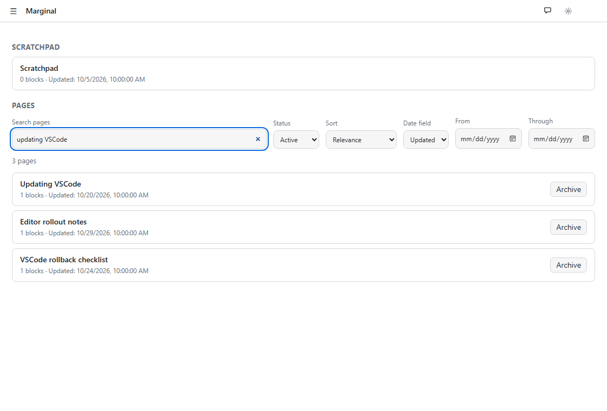
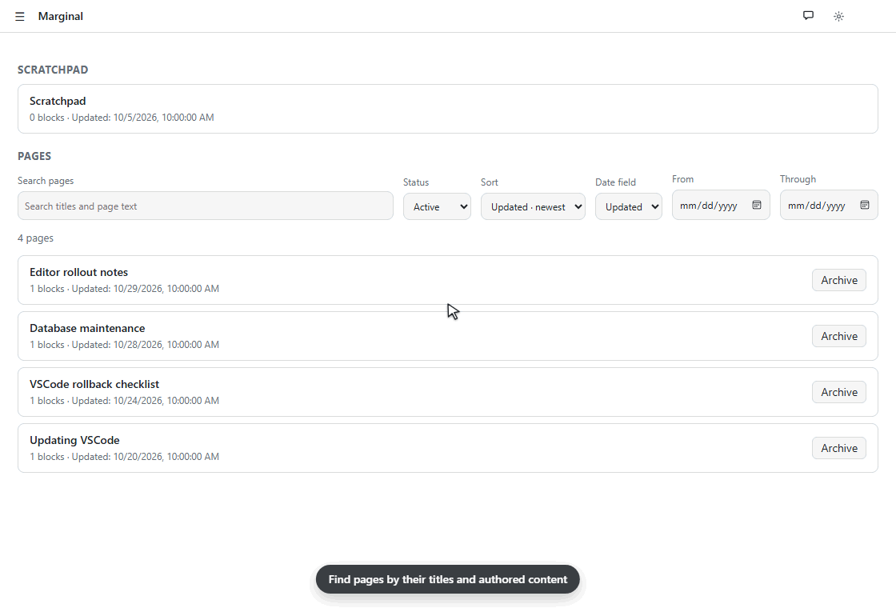
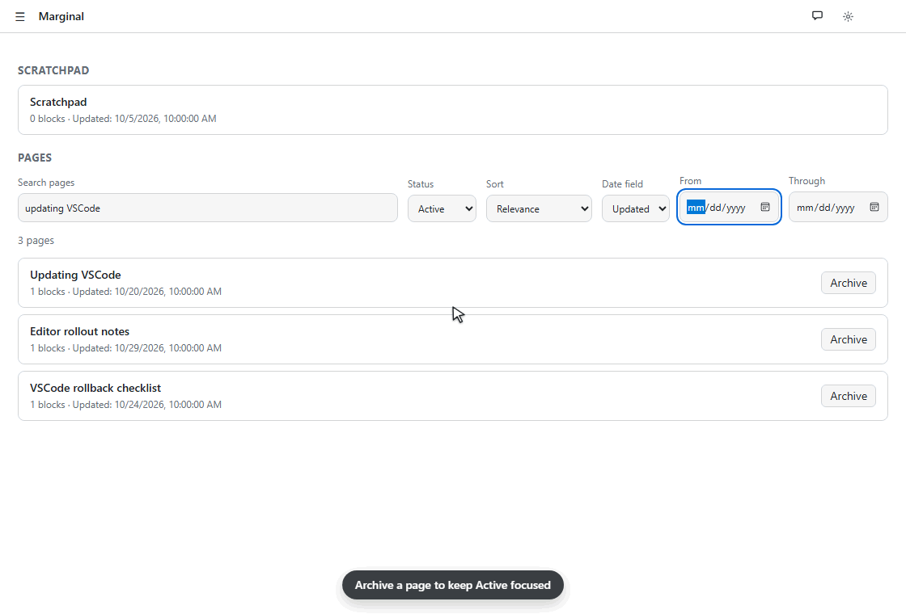
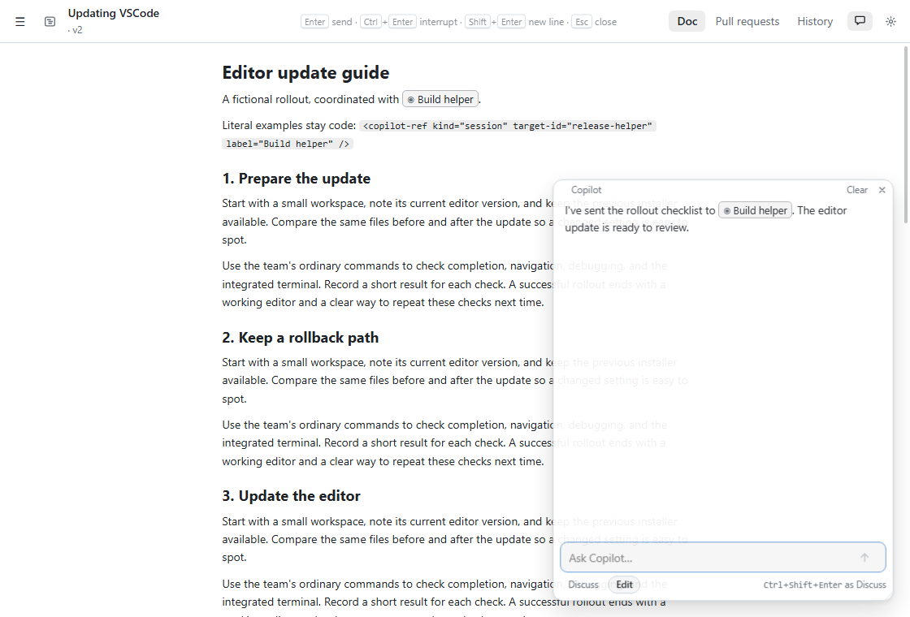
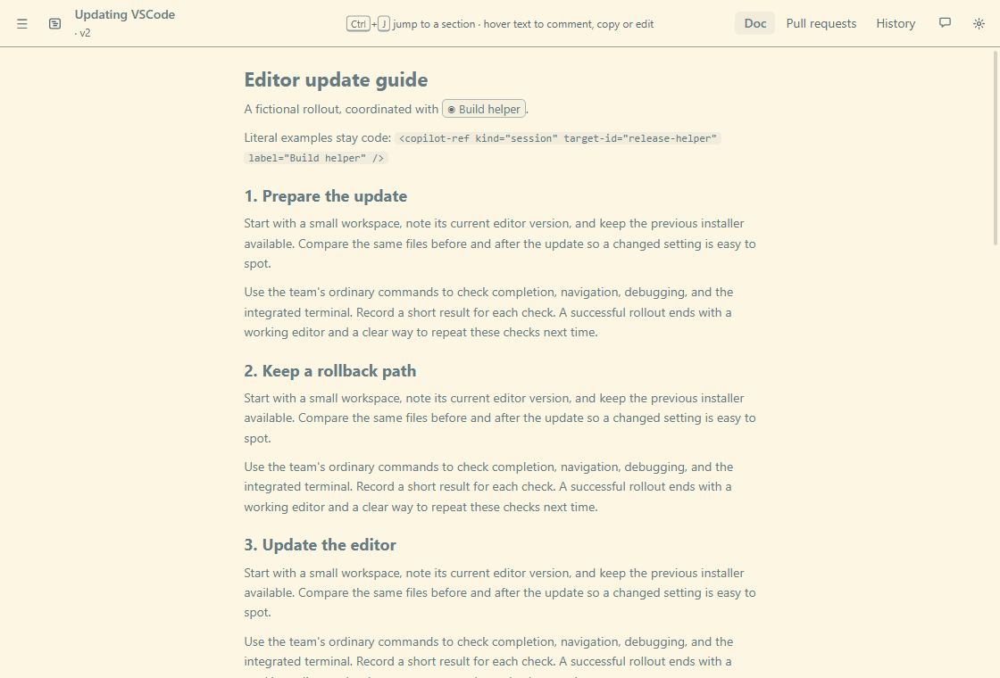
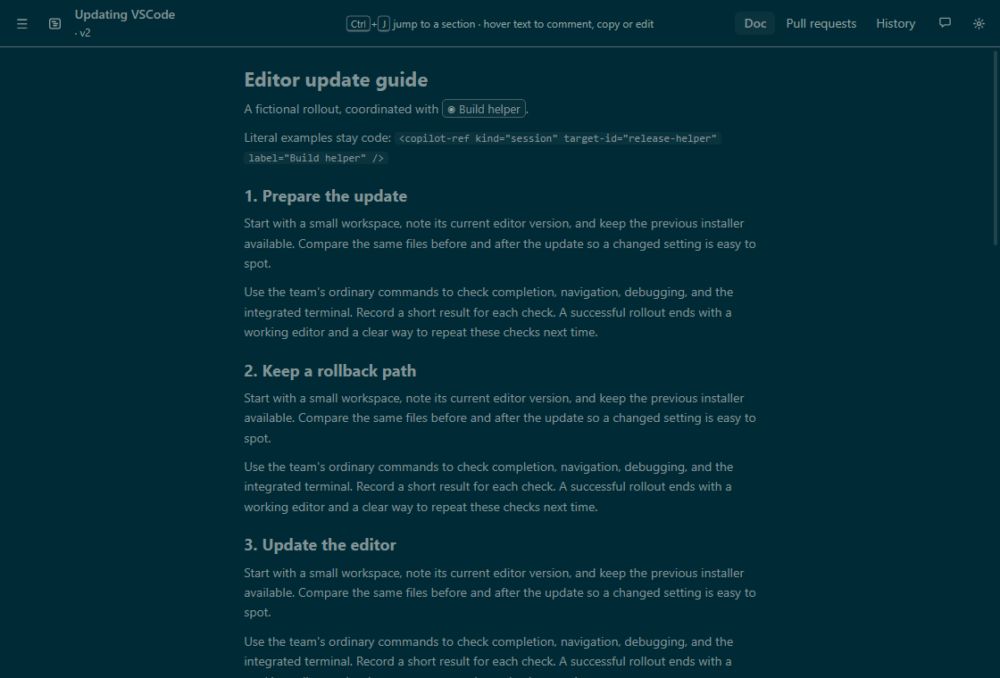
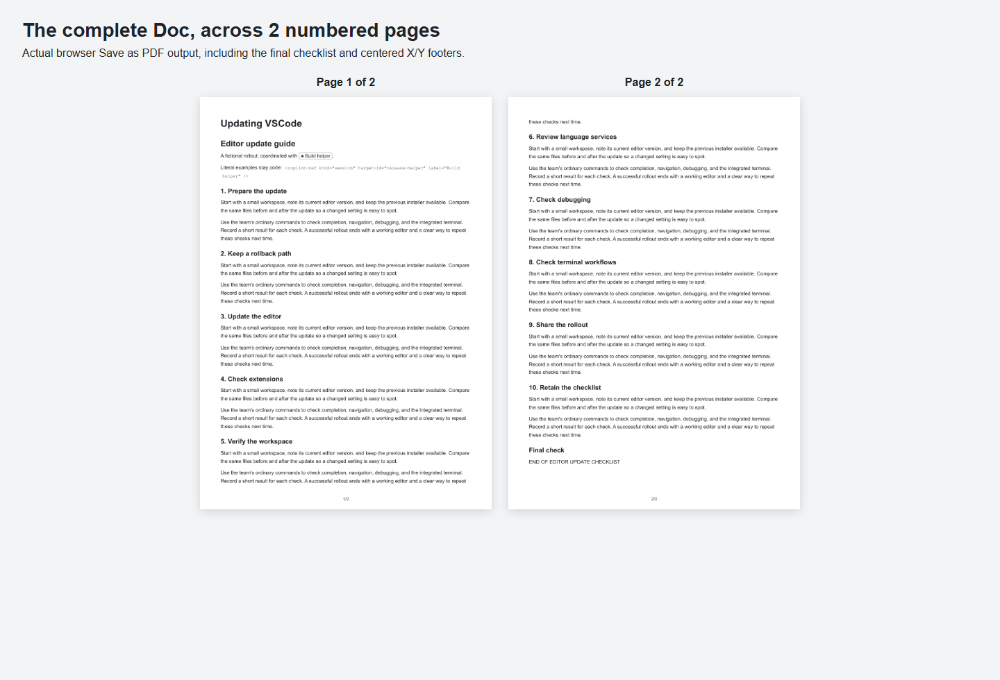

# Finding, organizing and printing pages

**Home** keeps the scratchpad at the top and your pages below it. Use the search, status, sort and date controls together to find a page, then click its title to open it.

## Search and sort

Search checks current page titles and authored content: prose, code blocks, diagram labels, explanations and notes. Every query word must appear somewhere in the page. Matching is case-insensitive; exact phrases and title matches rank higher. Searching `updating VSCode`, for example, can find both a page with that title and a checklist that mentions those words in its body.

The search covers what was authored in the page. Chat, past versions and code fetched from repository files are outside that corpus. The scratchpad remains separately available above the results.

**Sort** offers **Relevance**, **Updated** and **Created**, with newest or oldest first for dates. Entering a search initially selects Relevance; after you choose a sort explicitly, your choice stays in place as you refine the search. Relevance needs search text.

**Date field** chooses which date the **From** and **Through** controls filter. Both are inclusive local calendar days. Leave either end blank for an open-ended range. Date filtering is independent of sorting: you can filter by Updated dates while sorting by Created dates. Invalid or reversed ranges show an error instead of silently changing the range.

## Archive and restore

Click **Archive** on a page's Home card to move it out of **Active**. Choose **Archived** to find archived pages, or **All** to see both. Search, sorting and date filters work in each view. **Unarchive** returns a page to Active.

Archiving preserves the page's content, creation/update dates, history and attached work. An archived page remains editable and accessible through its existing panel. Its Command work and PR watchers continue under their usual session/ownership rules. Use the Command or Pull requests controls to stop that work; archiving only changes the page's catalog status. The scratchpad is always available and cannot be archived.

## Session references

Recognized Copilot session references in prose and chat appear as labeled pills, making a reply about another session easier to read. These pills identify the separate session; they are currently noninteractive. Literal code examples keep their raw tags, and editing prose preserves the original reference source.

## Browser themes

Open the page in your browser with the globe button, then open **Settings** and choose **Solarized Light** or **Solarized Dark**. The choice is shared by browser windows. Embedded panels continue to follow the Copilot host's theme.

| Solarized Light | Solarized Dark |
|---|---|
|  |  |

## Print the complete Doc

Open the page in your browser, select the **Doc** tab, finish any inline edits, and let sources and images load. Use the browser's **Print / Save as PDF**. Marginal prints the complete current rendition, including folded sections, with paper colors and app controls hidden. Code and tables wrap across sheets; graphics scale intact.

Current Chromium-based browsers add centered **X/Y** page numbers automatically. Leave room in the bottom margin, and turn off the browser's **Headers and footers** to omit its date, URL and duplicate numbering. Use the browser's landscape or scale options for dense diagrams. Printing targets the Doc rendition; printing other tabs is outside this focused support.

