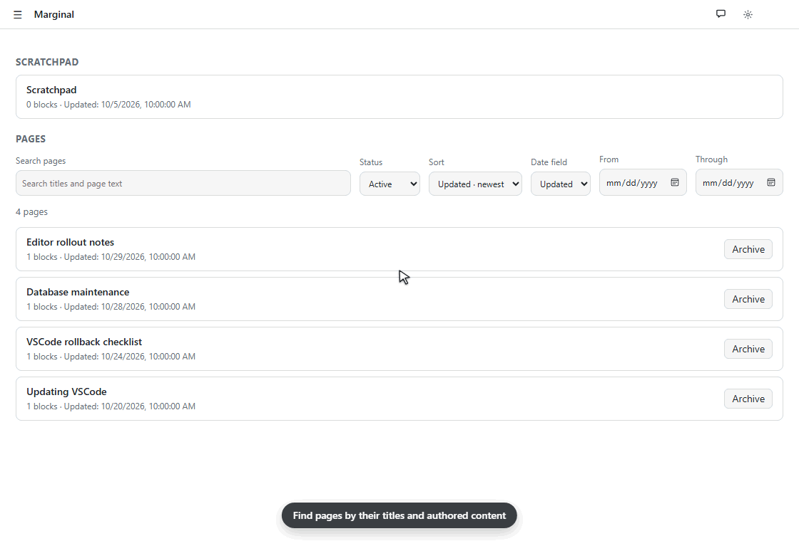
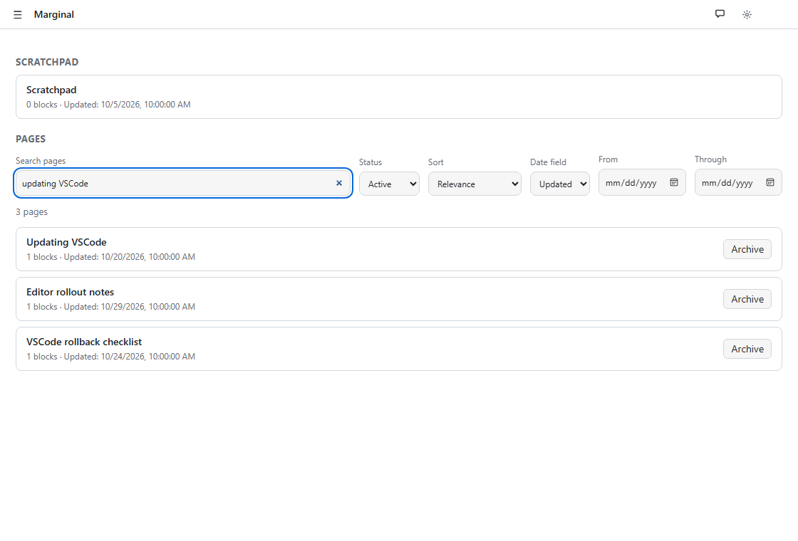
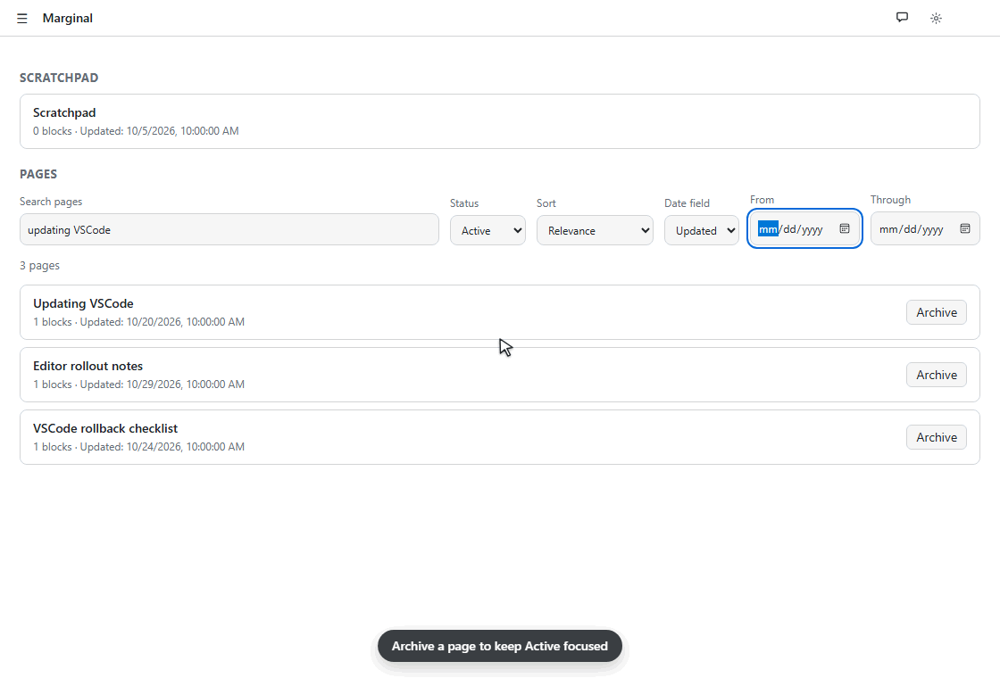
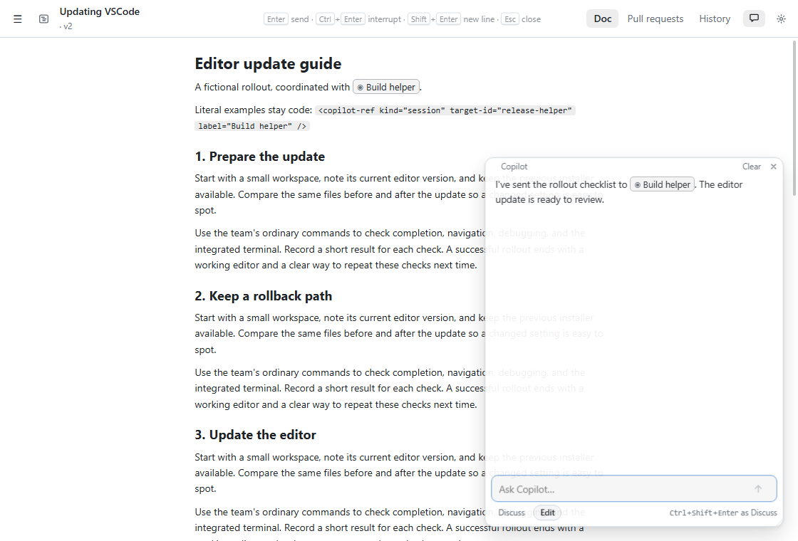
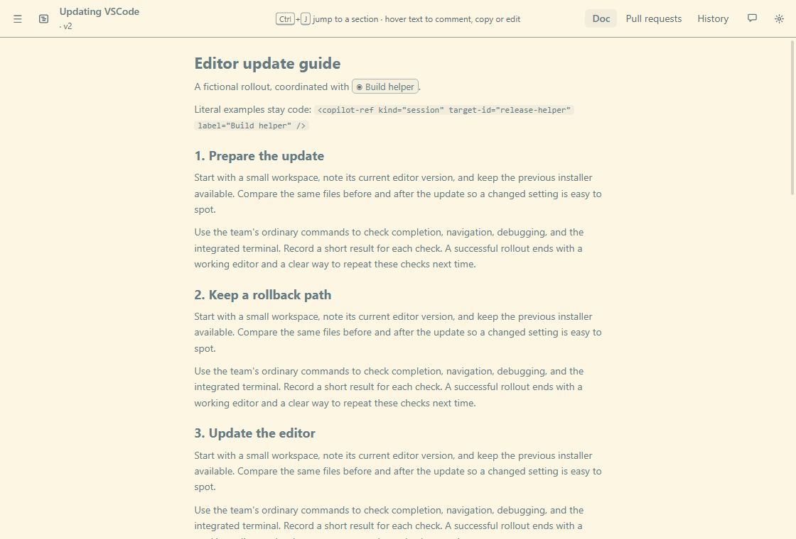
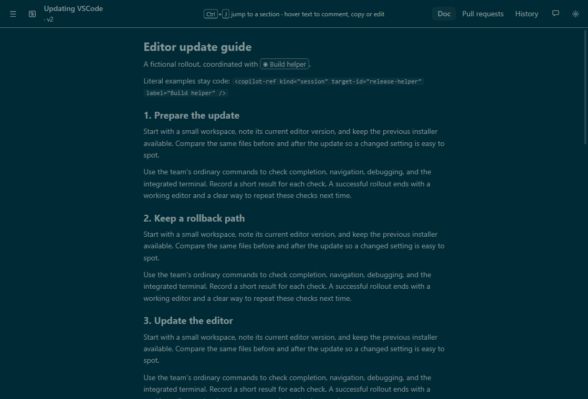
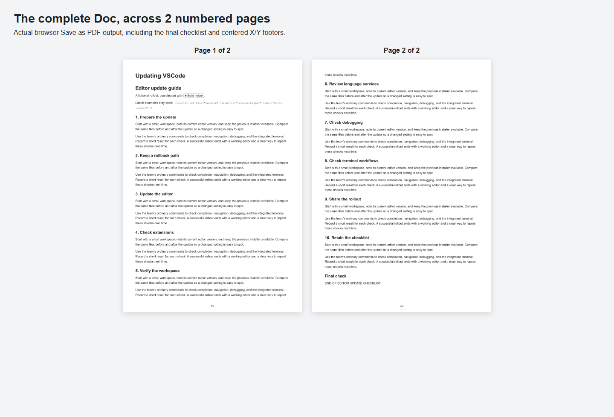

# Page management and reading improvements

Draft notes for the next release. All demonstrations use fictional pages.

## What it looks like

### Find the page you meant

Home now has a search bar for page titles and authored content, including code, diagram labels and notes. Search for **updating VSCode** and the list narrows to matching pages, with title matches and exact phrases first.

Choose **Relevance**, **Updated** or **Created** order. Date sorts work newest or oldest first; optional **From** and **Through** controls filter by local calendar days. The date field is independent of the sort, so you can find pages updated this week and order them by creation date.

### Keep Active focused, keep the page

**Archive** moves a page out of Active while preserving its content, dates, history and attached work. Switch to **Archived** to find it again, or **All** to search both groups. **Unarchive** brings it back. Archived pages stay editable; the scratchpad stays separate and always available.

### Read references to other sessions

Copilot's recognized session-reference tags now appear as subtle labeled pills in prose and chat. A reply about **Build helper** reads naturally, while a code example still shows its literal tag. The pills identify a separate session; opening that session remains deferred.

### Solarized, light and dark

Browser windows gain **Solarized Light** and **Solarized Dark** in **Settings**. Both use the same familiar reading layout. Embedded panels continue to use the Copilot host's theme.

| Solarized Light | Solarized Dark |
|---|---|
|  |  |

### A complete, numbered printout

Open the browser's **Doc** tab and use **Print / Save as PDF**. Long docs now flow across sheets, including folded sections. Printed pages use paper-friendly colors, hide app controls, wrap code and tables, and fit diagrams intact.

Current Chromium-based browsers add centered **X/Y** footers automatically: **1/3**, **2/3**, **3/3**, or **1/1** for a single sheet. Leave room in the bottom margin and turn off browser **Headers and footers** to omit its date/URL and extra numbering.

### Upgrading from 0.9

Update the plugin and reload extensions or restart Copilot. Existing pages remain Active; your stored content and history stay in place. Home defaults to recently updated pages. Search covers current authored content, with chat, history and fetched repository code outside its scope.

Archiving changes catalog status and preserves attached work. Command work and PR watchers keep their normal session/ownership behavior. Session-reference pills are static, browser theme choices apply to standalone windows, and focused printing applies to the browser Doc tab.

See [Finding, organizing and printing pages](pages.md) for the controls and printing guidance.

---

### Added

- **Page management and reading improvements.** Find pages with full authored-content search, phrase/title relevance, Updated/Created sorting and local-day date filters; archive and unarchive pages while preserving their content, dates and attached work. Copilot session references render as static separate-session pills in prose/chat, with literal code examples and editable source preserved. Browser windows gain Solarized Light and Dark themes. Browser Doc printing flows across multiple sheets, includes folded content, hides app controls and uses a paper palette with wrapped code/tables and intact scaled graphics; current Chromium-based browsers add centered X/Y page footers.
